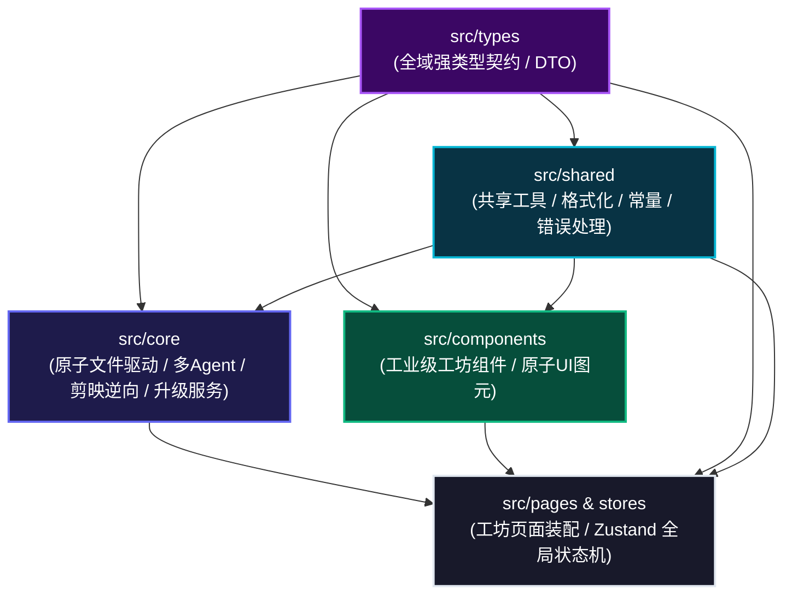
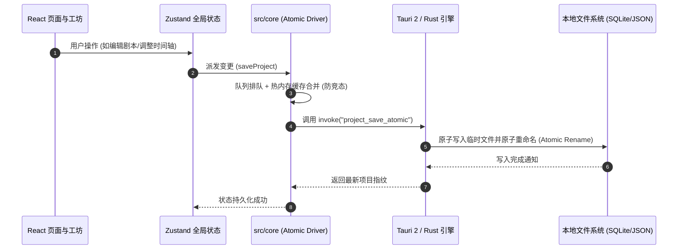

# 系统整体架构与分层设计

## 1. 架构总览与清晰分层

Fablr (剧工) 采用标准现代化的 **清晰模块化架构 (Modular Clean Architecture)**，将全域强类型契约、共享工具库、领域核心服务、UI 组件与桌面原生运行时严格分层解耦：

---

## 2. 各模块职责边界与规范

| 模块目录 | 职责范围 | 典型模块 / 导出品 | 依赖约束 |
| :--- | :--- | :--- | :--- |
| **`src/types`** | 系统全域类型契约、领域模型 DTO、IPC 接口规范 | `Project`, `ScriptBlock`, `AssetClip`, `AppUpdateInfo` | **零业务依赖**（纯 TypeScript 类型定义） |
| **`src/shared`** | 纯函数工具、文件大小/时间格式化、平台感知、防抖重试 | `formatFileSize`, `formatDuration`, `notify`, `delay` | 仅允许依赖基础工具与 `src/types` |
| **`src/core`** | 领域核心服务、防竞态文件驱动、多 Agent 状态机、更新检测 | `AtomicProjectFileDriver`, `UpdaterService`, `DramaAgents` | 依赖 `types` 与 `shared` |
| **`src/components`** | 工业级业务组件、通用原子组件、时间轴与播放器 | `VideoPlayer`, `Timeline`, `Button`, `Dialog` | 依赖 `types`, `shared`, `core` |
| **`src/pages` & `src/stores`** | 路由页面装配、Zustand 全局状态机、Tauri IPC 接入 | `AssetHubPage`, `ScriptStudioPage`, `WorkspacePage` | 聚合调用各层服务与组件 |

---

## 3. 全链路数据流转模型

---

## 4. 技术栈选型原则

1. **本地优先与绝对隐私**：所有媒体资产与草稿工程均存储于用户磁盘，零强制上传；
2. **轻量极致与秒级启动**：基于 Tauri 2 + Rust，杜绝传统 Chromium 庞大臃肿的内存占用；
3. **架构防腐与单向数据流**：强类型约束与清晰分层，彻底杜绝跨层循环引用与过度伪工程。
