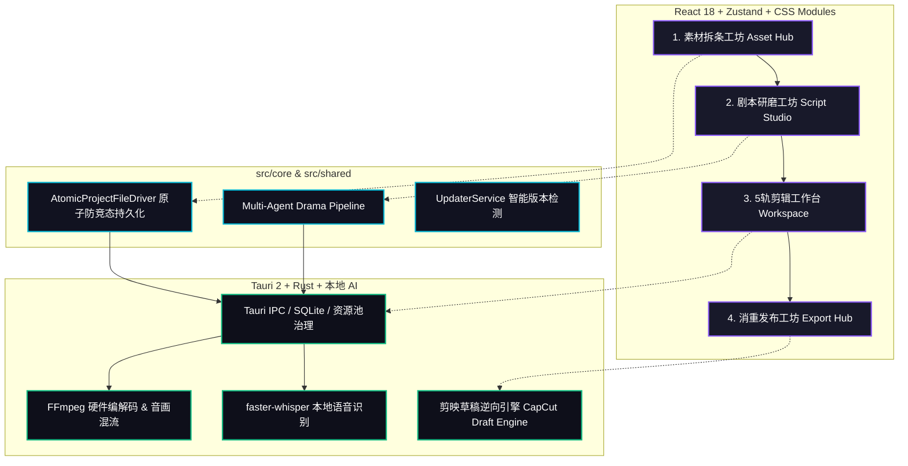

## 🏗️ 工业级系统全景图

## 📊 技术栈选型矩阵

| 层级 | 核心技术 | 架构定位与选型考量 |
| :--- | :--- | :--- |
| **桌面运行时** | **Tauri 2 + Rust** | 原生轻量化容器，安装包仅 ~15MB，内存占用极低，跨 macOS/Windows/Linux 统一。 |
| **前端应用** | **React 18 + Vite** | 组件化高度解耦，Zustand 状态机，CSS Modules 黑曜石工业风。 |
| **工程架构** | **模块化分层 (Modular Clean Architecture)** | `src/types` (全域类型契约) + `src/shared` (共享工具) + `src/core` (领域核心服务) + `src/components` (组件)。 |
| **音视频与 AI** | **FFmpeg + faster-whisper** | 本地硬件加速编解码、ASR 离线转写，多 Agent 大模型流式剧本研磨。 |
| **草稿与分发** | **CapCut Draft Reverse** | 逆向直接生成剪映全轨工程与 5 级消重参数，1 秒无损导入二次精剪。 |

[🚀 立即开始 5 分钟极速实战 →](/getting-started/03-quick-start)
